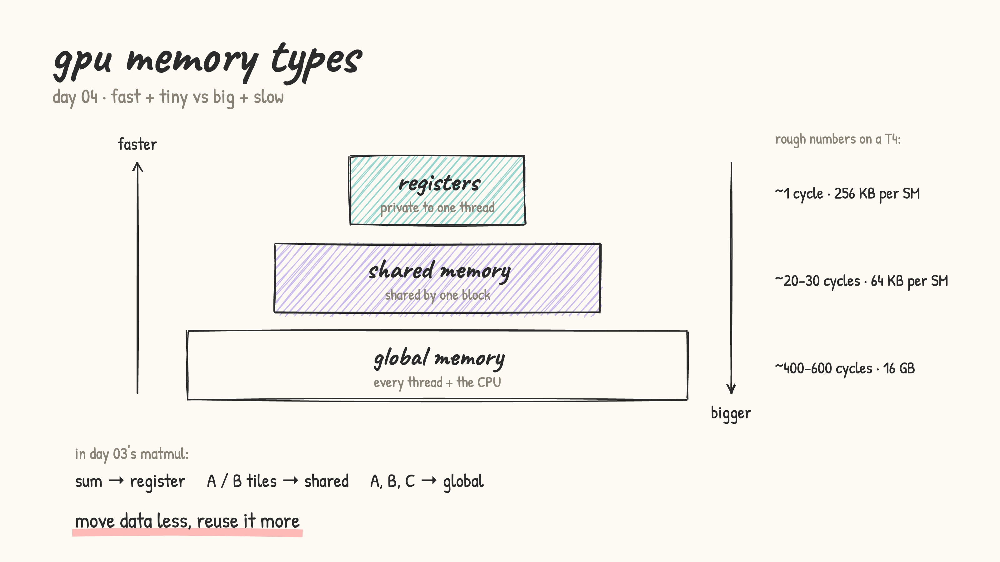
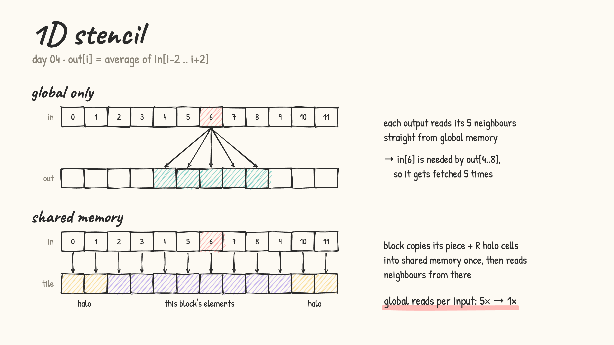

# Day 04: GPU memory types

- No single memory is fast, big and shared all at once, so the GPU has layers:
  - **registers**: private to one thread, fastest, tiny (e.g. the `sum` accumulator in matmul)
  - **shared memory**: shared by one block, fast, small (e.g. the A/B tiles in tiled matmul)
  - **global memory**: every thread + the CPU, huge, slow (inputs, weights, outputs)

  

- [device_memory_info.cu](device_memory_info.cu): prints the real sizes on the GPU (registers, shared memory, constant, L2, global, peak bandwidth)
- [stencil_1d.cu](stencil_1d.cu): `out[i]` = average of its 17 neighbours. The global-only version re-reads every input 17 times. The shared-memory version loads each block's piece + a halo once, then reads neighbours from shared memory

  

- tip: compile with `-Xptxas -v` to see how many registers and how much shared memory each kernel uses, and whether anything spills to (slow) local memory
- lesson: good kernels manage data movement as carefully as the math
