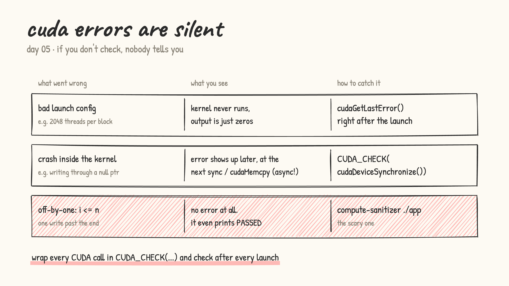
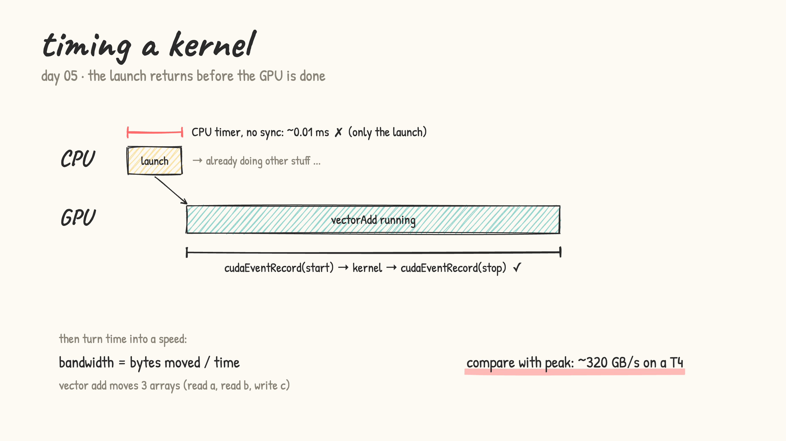

# Day 05: error checking, timing, tools

- CUDA errors are silent unless you check. Three kinds:
  - **bad launch** (e.g. 2048 threads per block): the kernel never runs. `cudaGetLastError()` right after the launch catches it
  - **crash inside the kernel** (e.g. a null pointer): since launches are async, the error only appears at the next `cudaDeviceSynchronize()` / `cudaMemcpy`. It's sticky, so every call after it fails too
  - **off-by-one** (`i <= n`): no error at all, it even prints PASSED. Only `compute-sanitizer` catches it

  

- [error_checking.cu](error_checking.cu): the first two kinds, with and without `CUDA_CHECK`
- [buggy_kernel.cu](buggy_kernel.cu): a hidden off-by-one. Run it, then run `compute-sanitizer ./buggy`

- timing: a CPU timer around a launch only measures the launch. `cudaEvent`s are recorded on the GPU's timeline, so they measure the real kernel time. Then bandwidth = bytes moved / time, compared with the GPU's peak
- [timing_bandwidth.cu](timing_bandwidth.cu): wrong vs right timing, then vector add GB/s and % of peak for block sizes 32 → 1024

  
