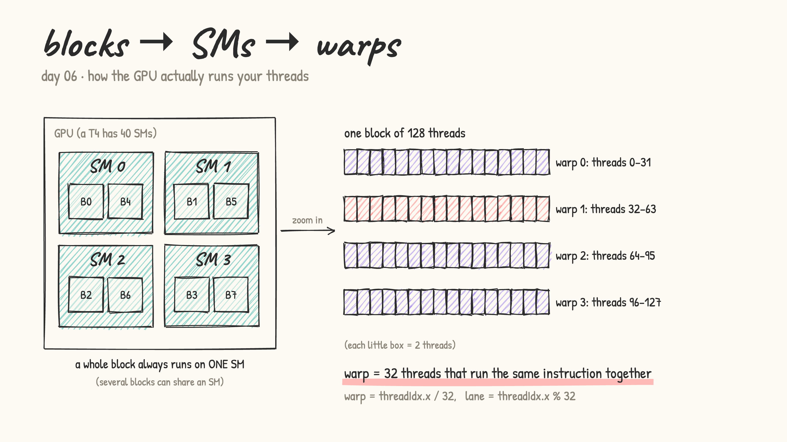
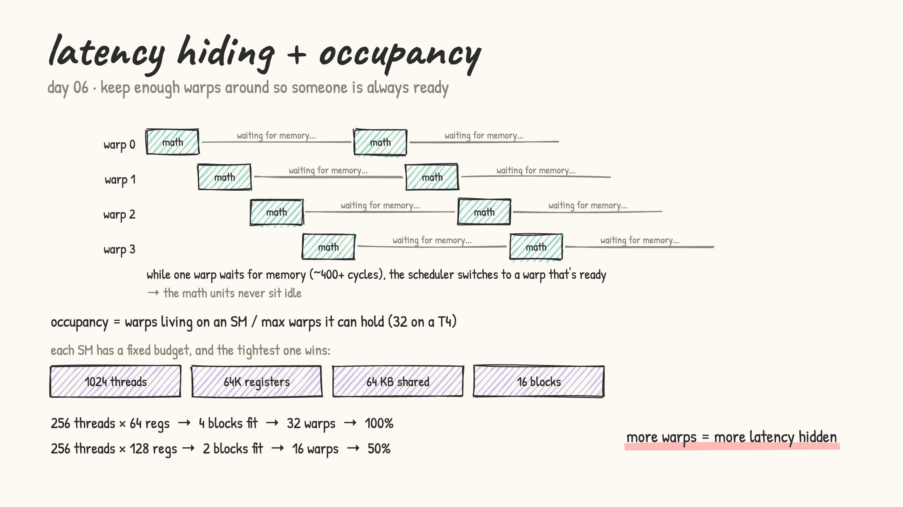

# Day 06: SMs, warps, occupancy

- the GPU is made of **SMs** (streaming multiprocessors, a T4 has 40). Every block is handed to one SM and stays there; an SM can hold several blocks at once
- inside an SM, threads run in **warps** of 32: 32 threads doing the same instruction at the same time. `warp = threadIdx.x / 32`, `lane = threadIdx.x % 32`

  

- [warps_and_sms.cu](warps_and_sms.cu): reads the hardware `%smid` register to show which SM each block landed on, and prints warp/lane numbers

- **latency hiding**: a global memory read takes ~400+ cycles. Instead of waiting, the SM's scheduler switches to another warp that's ready. So you want *many* warps living on each SM
- **occupancy** = resident warps / max warps per SM (32 on a T4). It's limited by whichever per-SM budget runs out first: threads (1024), registers (64K), shared memory (64 KB) or blocks (16)
  - 256 threads × 64 registers → 4 blocks fit → 32 warps → 100%
  - 256 threads × 128 registers → 2 blocks fit → 16 warps → 50%

  

- [occupancy.cu](occupancy.cu): a light, a register-heavy and a shared-memory-heavy kernel. Prints registers per thread and occupancy for block sizes 64 → 1024, plus CUDA's suggested block size
- [grid_stride.cu](grid_stride.cu): a grid-stride loop (`i += gridDim.x * blockDim.x`) lets a small, fixed grid (a few blocks per SM) handle any n. Compared against one thread per element
