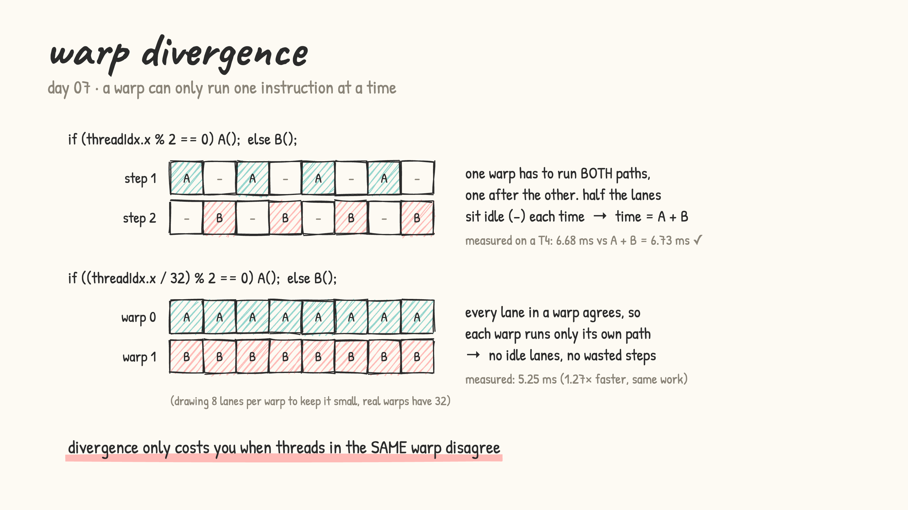
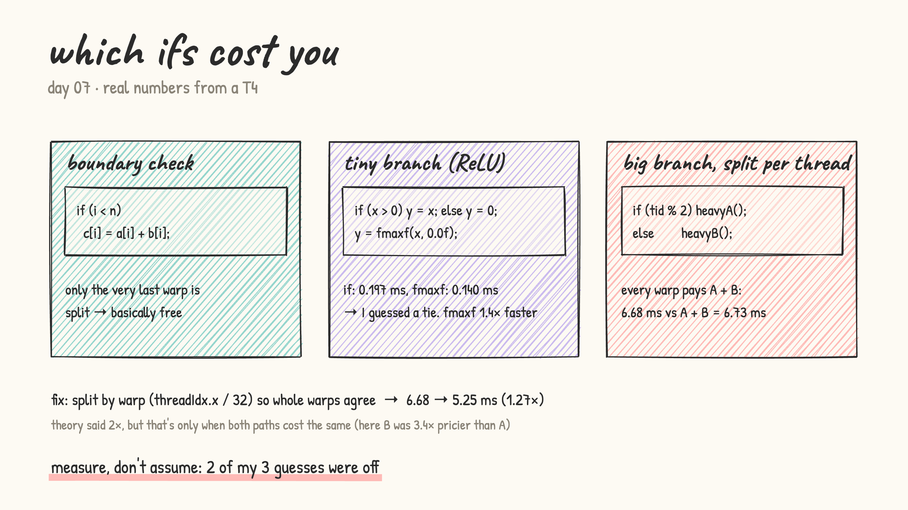

# Day 07: warp divergence

- from first principles: the 32 threads of a warp share one instruction stream, so at any moment the whole warp runs the *same* instruction
- if threads in the same warp take different sides of an `if`, the warp can't do both at once. It runs side A with the other threads switched off, then side B. Time = A + B. That's **warp divergence**
- if whole warps agree (split by `threadIdx.x / 32` instead of `threadIdx.x`), each warp runs only its own path and nothing is wasted

  

- results on a real T4 (LeetGPU, after warming the GPU up, median of 7 interleaved rounds):

  | kernel | time | theory said |
  |---|---|---|
  | all A | 1.52 ms | |
  | all B | 5.20 ms | |
  | branch per thread (diverged) | 6.68 ms | A + B = 6.73 ✅ |
  | branch per warp | 5.25 ms | (A+B)/2 = 3.36 ❌ |
  | ReLU with `if` | 0.197 ms | same as fmaxf ❌ |
  | ReLU with `fmaxf` | 0.140 ms | |

  - a diverged warp really pays A + B
  - splitting per warp instead of per thread: 6.68 → 5.25 ms (1.27×). Theory says 2×, but only when both paths cost the same; here B was 3.4× pricier than A. Per warp landed at ≈ B, likely because every block holds both kinds of warps and a block is only done when its slowest warp finishes
  - the tiny ReLU `if` was *not* free: `fmaxf` was 1.4× faster
  - `if (i < n)` only splits the last warp, so it's basically free

  

- benchmarking lesson: the first run said "all A" took 3.96 ms, and the same kernel later took 1.52 ms. A cold GPU starts at a low clock. Fix: warm up for ~0.5 s, interleave the kernels in rounds, report the median + spread

- [warp_divergence.cu](warp_divergence.cu): LeetGPU format (paste into the Vector Addition challenge, press Run)
