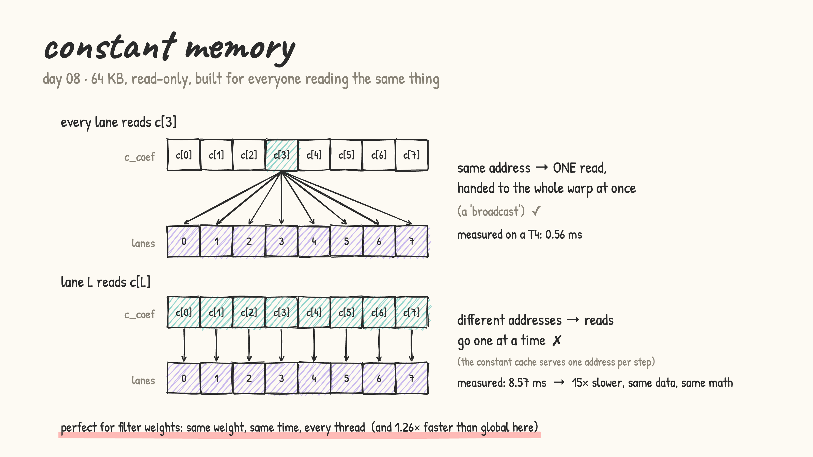
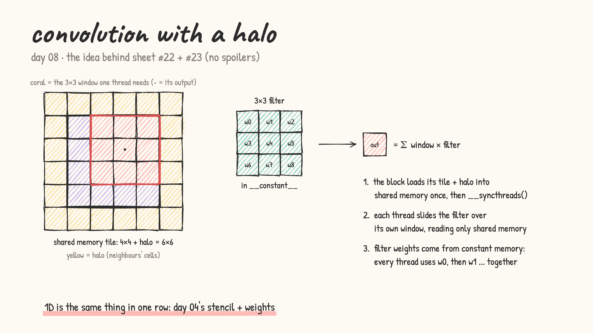

# Day 08: constant memory + convolution with a halo

- from first principles: a convolution filter's weights are read by *every* thread, and at each step every thread wants the *same* weight. Constant memory is built for exactly that
- `__constant__` = 64 KB, read-only from the GPU, filled from the CPU with `cudaMemcpyToSymbol`. It has its own cache:
  - all lanes of a warp read the **same** address → one read, broadcast to the whole warp
  - lanes read **different** addresses → the reads queue up one at a time

  

- [constant_memory.cu](constant_memory.cu): LeetGPU format (paste into the Vector Addition challenge, press Run). Times constant-broadcast vs constant-scattered vs global memory for 64 coefficients per element.

  results on a real T4 (LeetGPU, warmed up, median of 7 interleaved rounds):

  | kernel | time | |
  |---|---|---|
  | constant, broadcast | 0.560 ms | fastest |
  | constant, scattered | 8.565 ms | 15.3× slower: same data, lanes just ask for different addresses |
  | global, broadcast | 0.705 ms | constant is 1.26× faster (global still benefits from L1 caching) |

- convolution = stencil + weights. Each block loads its tile **plus a halo** (the neighbours' cells it also needs) into shared memory once, `__syncthreads()`, then every thread slides the filter over its own window. The weights come from constant memory

  

- practice (my own solutions): kernel sheet #22 1D Convolution, #23 2D Convolution
