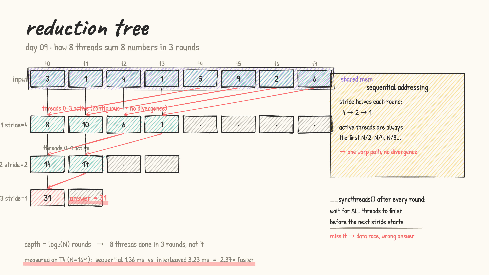
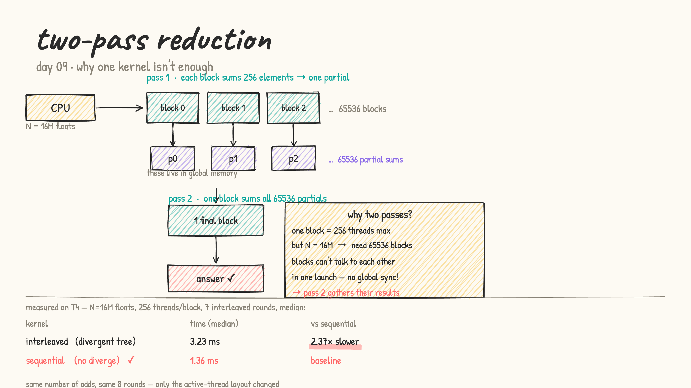

# Day 09: parallel reduction

- from first principles: "add N numbers together" sounds embarrassingly parallel, but there's a catch. Two threads can't both read-modify-write the same accumulator at the same time. The right approach is a **reduction tree**: every round, half the threads pair up, add their values, and pass one result forward. After log₂(N) rounds, one thread holds the total.

- a block of 256 threads sums 256 elements in just 8 rounds (instead of 255 serial additions). The depth is logarithmic, not linear. That's the whole win.

- **shared memory is key**: each thread loads one element from global memory into shared memory *once*. All the tree rounds then read/write only shared memory, which sits on-chip and is ~100× faster than global.

- **`__syncthreads()` is mandatory between rounds**: every thread in the block must finish writing its value before any thread reads from it for the next round. Miss it → data race → wrong answer. No error message, just silently wrong.

  

- **the divergence problem**: the "obvious" tree layout uses `if (tid % (2*stride) == 0)` to pick active threads. In round 1: threads 0, 2, 4, 6 are active; 1, 3, 5, 7 idle — interleaved. One warp has to run BOTH paths → warp divergence (Day 07: the warp runs the inactive path too, just with lanes masked off).

- **sequential addressing (the fix)**: flip the stride direction. Active threads are always the *first* N/2, N/4, ... — a contiguous prefix of the block. Round 1: threads 0–3 work, threads 4–7 idle. Two contiguous groups → one warp path per group → no divergence.

- **why two kernel launches?**: a single block is limited to 1024 threads. For N = 16M, you need 65536 blocks. Blocks can't synchronise with each other inside one launch — there's no GPU-wide `__syncthreads()`. Pattern:
  - **pass 1**: 65536 blocks each reduce 256 elements → 65536 partial sums in global memory
  - **pass 2**: one final block uses a **grid-stride loop** to accumulate all 65536 partials (each of the 256 threads loops over 256 partials), then tree-reduces to the answer

  (first attempt silently dropped 65280 of the 65536 partials and returned 65536 instead of 16 777 216 — the grid-stride loop was the fix)

  

- [reduction.cu](reduction.cu): LeetGPU format (v2). Compares `interleaved` (divergent tree + two-pass) vs `sequential` (non-divergent tree + two-pass) on N = 16M floats. Warm-up + 7 interleaved rounds + median reported.

  results on a real T4 (LeetGPU, warmed up, median of 7 interleaved rounds):

  | kernel | time | note |
  |---|---|---|
  | interleaved (divergent tree) | 3.23 ms | spread 3.2324–3.2329 ms |
  | sequential (no divergence) | 1.36 ms | spread 1.3633–1.3640 ms — **2.37× faster** |

  the spread is exceptionally tight (< 0.02%), which means the result is very trustworthy. same number of adds, same 8 rounds, same shared memory — only the active-thread layout changed.

  2.37× is larger than a "pure divergence" story would predict. the sequential layout also avoids shared-memory bank conflicts in the large early rounds (stride 128, 64 pairs threads far apart across banks). both effects add up.

- practice (my own solutions): kernel sheet #26 Reduction ★, #27 Max of Array, #30 Count Array Element
