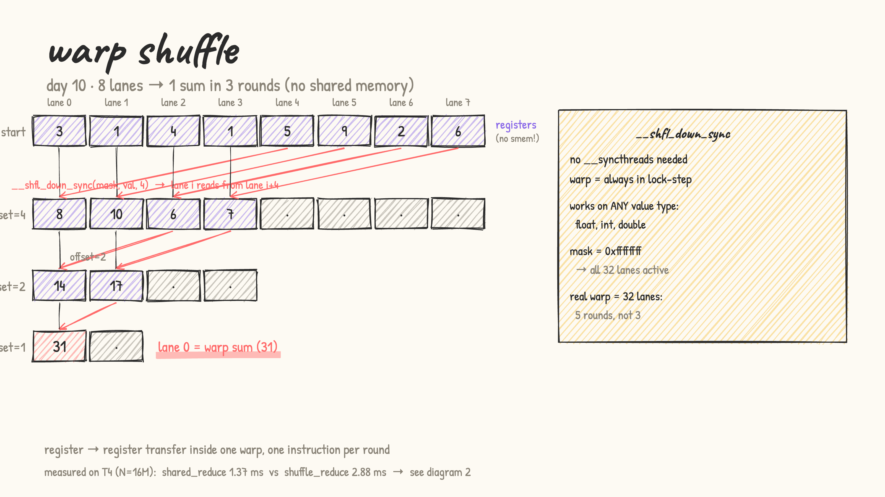
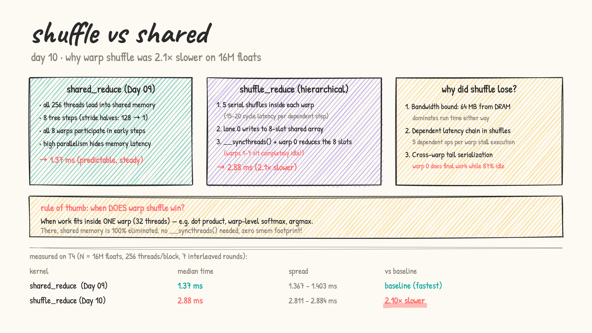

# Day 10: warp shuffles

- from first principles: Day 09 used shared memory to pass values between threads during reduction. But threads inside the same **warp** (32 lanes) are always in lock-step — they execute the same instruction together. So one thread can *directly read another thread's register* without going through shared memory at all.

- `__shfl_down_sync(mask, val, offset)` = "give me the value held by the thread at lane (my_lane + offset)". No write to memory, no barrier — just a register-to-register transfer in a single instruction.

- the four shuffle instructions:
  | instruction | reads from | typical use |
  |---|---|---|
  | `__shfl_sync` | any named lane | broadcast from lane 0 |
  | `__shfl_up_sync` | lane − δ | prefix scan |
  | `__shfl_down_sync` | lane + δ | reduction |
  | `__shfl_xor_sync` | lane XOR mask | butterfly all-reduce |

- **warp reduction in 5 rounds** (for 32 lanes):
  - round 1: offset=16 → lane 0 adds lane 16, lane 1 adds lane 17, …
  - round 2: offset=8 → lane 0 now holds 4 original values
  - … after round 5 (offset=1), lane 0 = sum of all 32 values
  - no `__syncthreads()` needed — warp is always in hardware sync

  

- **block reduction with shuffles**: for 256 threads = 8 warps:
  1. each warp reduces to lane 0 (5 shuffle rounds, zero shared memory)
  2. the 8 lane-0 values go into a **tiny** 8-float shared array (vs 256 floats for the Day 09 approach)
  3. one `__syncthreads()`, then warp 0 reduces those 8 values with one more shuffle pass

- [warp_shuffle.cu](warp_shuffle.cu): LeetGPU format. Times `shared_reduce` (Day 09 baseline) vs `shuffle_reduce` on N = 16M floats. Also demos `__shfl_sync` broadcast.

  results on a real T4 (LeetGPU, warmed up, median of 7 interleaved rounds):

  | kernel | time | note |
  |---|---|---|
  | shared_reduce | 1.37 ms | spread 1.367 – 1.403 ms (baseline, fastest) |
  | shuffle_reduce | 2.88 ms | spread 2.811 – 2.884 ms (**2.10× slower**) |

  

### The Surprise: Why did warp shuffle lose by 2.1×?

Theory says shuffles bypass shared memory, so it should be faster, right? On the real T4, it was more than 2× slower. Here is why:

1. **Global memory bandwidth dominates**: Reading 64 MB (16M floats) from DRAM takes most of the kernel runtime anyway. Replacing intra-block reduction memory accesses with shuffles optimizes a part of the kernel that was already a small fraction of the total execution time.
2. **Dependent latency chain in shuffles**: `warpReduceSum` is 5 consecutive `__shfl_down_sync` calls, each depending on the result of the previous one. Each shuffle takes ~15–20 clock cycles. With a tight dependency chain, execution stalls on instruction latency. In contrast, the shared memory tree has parallelism across elements and warps, which the hardware scheduler overlaps effectively.
3. **Tail serialization**: In the block-level shuffle reduction, after warps write their 8 partial sums to shared memory, only **warp 0** finishes the reduction. Warps 1–7 sit completely idle (87.5% of the block is stalled).

**Rule of thumb**: Warp shuffle wins when the problem fits inside a **single warp** (32 threads) — like dot products, warp-level softmax, or argmax. In those cases, shared memory is completely eliminated (0 bytes allocated, 0 syncs). When you still need cross-warp reduction, the shuffle overhead + serialized tail can easily make it slower than pure shared memory.

- practice (my own solutions): kernel sheet #28 Dot Product ★, #31 Mean and Variance ★, #32 Row-wise Argmax ★, #18 GEMV ★, #29 MSE
