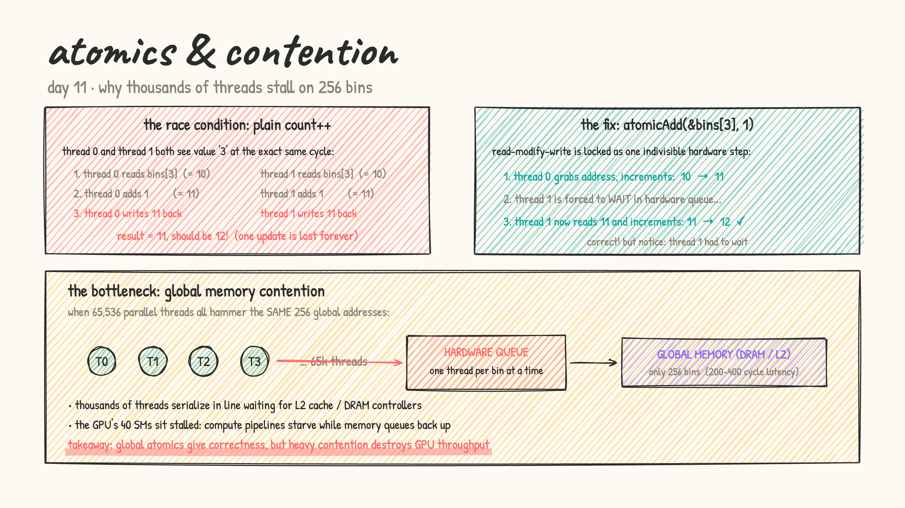
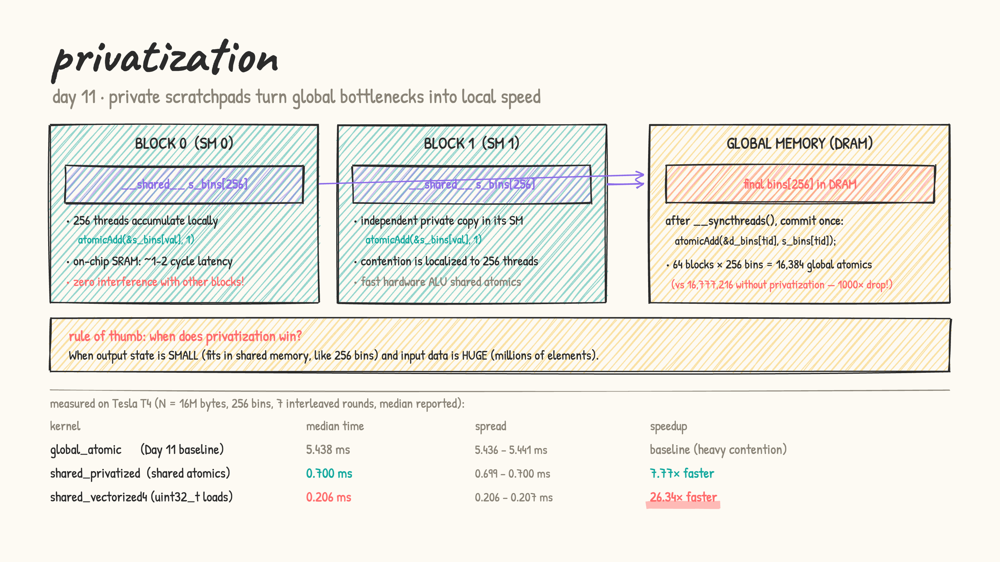

# Day 11: atomics & histogram

- **from first principles:** we want to build a 256-bin histogram over $N = 16\text{M}$ bytes ($16,777,216$ elements). In serial C, `bins[val]++` is trivial. But on a GPU with tens of thousands of concurrent threads, `bins[val]++` is **not atomic** — it consists of three separate hardware steps:
  1. Read `bins[val]` from memory into a register
  2. Increment the register: `reg += 1`
  3. Write the register back to `bins[val]`
  If two threads process the same value simultaneously, both read the old value, both increment, and both write back the same number. One increment is completely lost (data race!).

- **solution 1: hardware atomics (`atomicAdd`)**:
  - `atomicAdd(&bins[val], 1)` turns the read-modify-write into a single indivisible hardware transaction.
  - Correctness is guaranteed, but a new performance bottleneck appears: **contention**.
  - Thousands of parallel threads across all SMs funnel into the exact same 256 global memory addresses. The L2 cache and memory controllers cannot serve concurrent writes to the same address, so hardware **serializes** every thread into a queue. The GPU's massive parallel throughput collapses into single-file traffic.

  

- **solution 2: privatization (shared-memory scratchpads)**:
  - Why force all blocks across the entire GPU to fight over the same global bins?
  - Instead, give **each thread block its own private copy** of the 256 bins in fast on-chip shared memory:
    `__shared__ unsigned int s_bins[256];`
  - How it works:
    1. **Clear private bins**: threads initialize `s_bins[tid] = 0` (for `tid < 256`), then `__syncthreads()`.
    2. **Accumulate locally**: threads use shared atomics `atomicAdd(&s_bins[val], 1)`. Shared memory is on-chip SRAM (~1–2 cycle latency vs ~200–400 cycles for global DRAM), and contention is strictly isolated to the 256 threads in *that block*.
    3. **Commit to global**: after `__syncthreads()`, each block writes its 256 local sums into global memory:
       `if (tid < 256) atomicAdd(&out[tid], s_bins[tid]);`
  - **The math on contention reduction**:
    - With naive global atomics: $16,777,216$ global atomic writes.
    - With privatization (64 blocks): $64 \times 256 = 16,384$ global atomic writes.
    - That is a **1000× reduction** in global memory traffic!

- **solution 3: privatization + 4-byte vectorized loads (`uint32_t`)**:
  - Reading 1 byte per thread underutilizes the 32-byte/128-byte memory bus.
  - Reading a 4-byte `uint32_t` per iteration, unpacking the 4 bytes via bit shifts, and updating `s_bins` saturates global memory bandwidth.

- [histogram.cu](histogram.cu): LeetGPU format. Benchmarks `global_atomic` vs `shared_privatized` vs `shared_vectorized4` on $N = 16\text{M}$ bytes with warm-up + 7 interleaved rounds on an NVIDIA Tesla T4.

  results on a real Tesla T4:

  | kernel | time (median) | spread | speedup |
  |---|---|---|---|
  | `global_atomic` | 5.438 ms | 5.436 – 5.441 ms | baseline (heavy contention) |
  | `shared_privatized` | 0.700 ms | 0.699 – 0.700 ms | **7.77× faster** |
  | `shared_vectorized4` | 0.206 ms | 0.206 – 0.207 ms | **26.34× faster** |

  

### Why the massive 26.34× speedup?
1. **Contention elimination (7.77×)**: Global atomics force all 64 blocks (16,384 concurrent threads) to funnel updates into only 256 addresses in L2/DRAM, creating an enormous hardware queue. Privatization moves those updates to on-chip shared memory where only 256 threads in the same block contend, cutting global atomic writes down from 16.78M to just 16,384.
2. **Vectorized memory bus utilization (another 3.4× on top)**: Reading single bytes (`uint8_t`) severely underutilizes GPU memory transaction granularity (minimum transaction is 32 bytes). Loading 4 bytes as a `uint32_t` coalesces memory accesses, cuts load instruction count by 4×, and streams 16 MB in 0.206 ms (~77.7 GB/s effective throughput).

### Rule of thumb
**Privatize whenever the output state is small enough to fit in fast shared memory (like 256 bins) and the input data is large (millions of elements).** Localize contention to on-chip SRAM, then merge into global memory once per block.

- practice (my own solutions): kernel sheet #33 Histogramming ★, #34 Scatter Add
