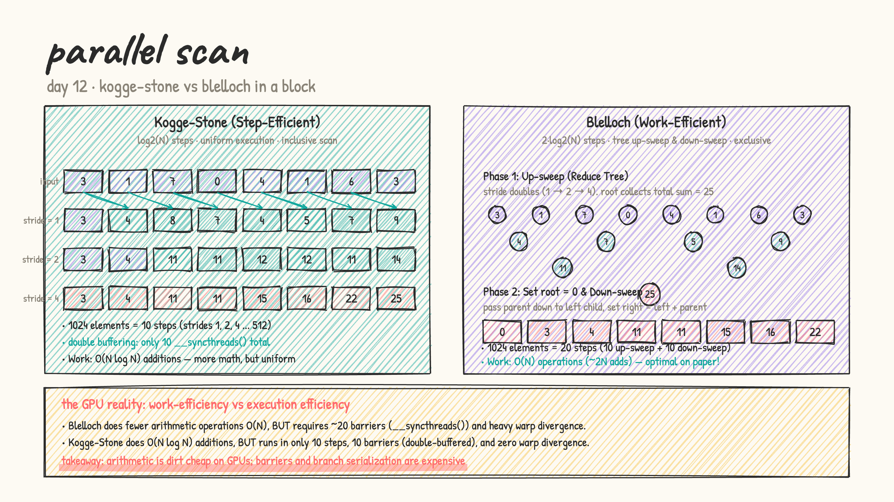
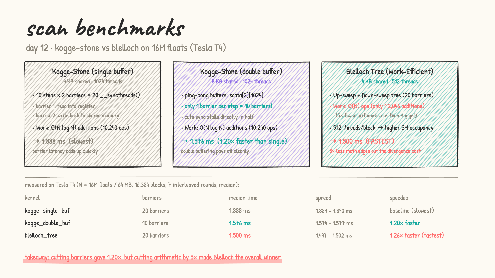

# Day 12: parallel scan (Kogge-Stone vs Blelloch)

- **from first principles:** prefix sum (scan) looks completely serial at first glance. Given an array $x$, we want:
  $$\text{out}[i] = \sum_{j=0}^{i} x[j] \quad \text{(inclusive scan)}$$
  or
  $$\text{out}[i] = \sum_{j=0}^{i-1} x[j] \quad \text{(exclusive scan, with } \text{out}[0] = 0\text{)}$$
  On a CPU, it is a single sequential loop: `sum += x[i]`. Because element $i$ depends on element $i-1$, it seems impossible to parallelize. But parallel scan is one of the most fundamental building blocks in parallel algorithms (stream compaction, radix sort, split, quicksort, building trees).

- **two classical single-block algorithms:**
  1. **Kogge-Stone (Step-Efficient)**:
     - Each round with $stride = 1, 2, 4, 8, \dots$, thread $i$ adds the value from thread $i - stride$.
     - Takes $\log_2(N)$ steps (10 steps for 1024 elements).
     - **Double-buffering**: Using ping-pong buffers in shared memory (`__shared__ float sdata[2][1024]`) avoids race conditions and requires only **1 barrier (`__syncthreads()`) per step** (10 barriers total).
     - Total work: $O(N \log N)$ additions ($\sim 10,240$ operations per 1024-element block).
  2. **Blelloch (Work-Efficient)**:
     - Two phases: **Up-sweep** (reduce tree building partial sums) and **Down-sweep** (distributing prefix sums from the root).
     - Root is set to 0 to generate exclusive scan.
     - Total work: $O(N)$ operations ($\approx 2,046$ operations per 1024-element block — **$5\times$ less arithmetic than Kogge!**).
     - Steps: $2 \log_2(N)$ steps ($\approx 20$ barriers for 1024 elements).

  

- [scan.cu](scan.cu): LeetGPU format. Benchmarks three implementations on $N = 16\text{M}$ floats ($16,777,216$ elements / 64 MB across $16,384$ blocks of 1024 elements):
  1. `kogge_single_buf`: 10 steps, 20 barriers, single-buffer shared memory (4 KB) with register temps.
  2. `kogge_double_buf`: 10 steps, 10 barriers, double-buffered shared memory (8 KB).
  3. `blelloch_tree`: 20 steps, 20 barriers, work-efficient binary tree (4 KB, 512 threads).

  results on a real Tesla T4 (median of 7 interleaved rounds):

  | kernel | barriers | time (median) | spread | vs single-buffer |
  |---|---|---|---|---|
  | `kogge_single_buf` | 20 barriers | 1.888 ms | 1.887 – 1.890 ms | baseline (slowest) |
  | `kogge_double_buf` | 10 barriers | 1.576 ms | 1.574 – 1.577 ms | **1.20× faster** |
  | `blelloch_tree` | 20 barriers | 1.500 ms | 1.497 – 1.502 ms | **1.26× faster (fastest)** |

  

### The Hardware Analysis: Why did these timings happen?

1. **Double-buffering cuts barrier stalls ($1.20\times$ speedup)**:
   `kogge_single_buf` and `kogge_double_buf` do the exact same arithmetic math ($10,240$ additions per block). But single-buffer requires two barriers per step (one after reading into register, one after writing to shared memory) to prevent data hazards. Double-buffering ping-pongs between two shared arrays, cutting barriers from 20 down to 10 and saving 0.31 ms.
2. **Work-efficiency beats warp divergence on large blocks**:
   Blelloch has 20 barriers and suffers branch divergence near the tree root. However, Blelloch does only $\approx 2,046$ additions per block compared to Kogge-Stone's $10,240$ additions (**$5\times$ fewer math ops!**). Furthermore, Blelloch only needs 512 threads per block (each thread handles 2 elements) and 4 KB shared memory, allowing higher SM occupancy. On a full 1024-element block, the massive $5\times$ reduction in arithmetic operations outweighed the divergence cost, making Blelloch the overall fastest at **1.500 ms**.

- practice (my own solutions): kernel sheet #35 Prefix Sum ★, #36 Stream Compaction ★
