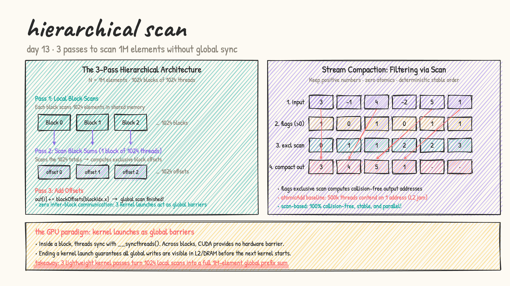
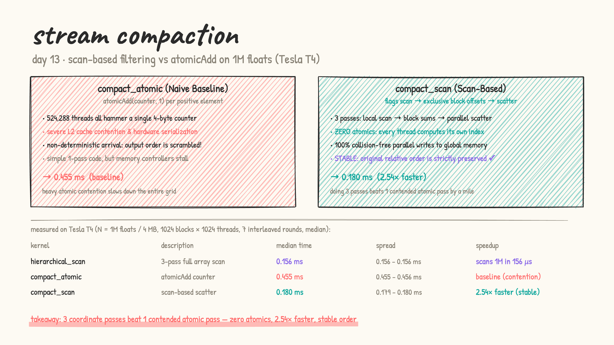

# Day 13: large-array scan & stream compaction

- **from first principles:** on Day 12, we scanned up to 1024 elements in a single block using shared memory. But real-world data has millions of elements. If $N = 1\text{M}$ ($1,048,576$ floats), we need 1024 blocks.
- **the fundamental challenge:** CUDA provides `__syncthreads()` to synchronize threads *inside* a block, but **no hardware barrier exists across blocks**. Blocks run independently and asynchronously across the GPU's streaming multiprocessors (SMs).
- **the solution: 3-pass hierarchical scan (scan-then-add):**
  1. **Pass 1: Local Block Scans**
     - 1024 blocks of 1024 threads.
     - Each block scans its 1024 elements in shared memory and stores its scanned elements to global memory.
     - The last thread in each block writes the block total into an auxiliary array: `blockSums[blockIdx.x]`.
  2. **Pass 2: Scan Block Sums**
     - Exactly **1 block of 1024 threads** scans the 1024 block totals!
     - By converting to an exclusive scan, `blockOffsets[b]` contains the sum of all elements in all preceding blocks ($0 \dots b-1$).
  3. **Pass 3: Add Offsets**
     - 1024 blocks of 1024 threads.
     - Each block adds its exclusive block offset to all of its elements: `out[i] += blockOffsets[blockIdx.x]`.
     - Kernel launch completion acts as the global barrier!

  

- **the killer application: stream compaction (filtering without atomics)**:
  - Suppose we want to filter an array of 1M elements, keeping only positive numbers (~524k elements kept).
  - **Naive atomic baseline**: every thread with `in[i] > 0` executes `atomicAdd(counter, 1)` to claim an output slot. **524,288 threads contend on a single 4-byte address** in global memory, causing massive hardware serialization and scrambling the output order.
  - **Scan-based stream compaction**:
    1. Set predicate flag: `flag = (in[i] > 0) ? 1.0f : 0.0f`
    2. Run hierarchical prefix sum on the flags. The exclusive scan gives each thread its **exact, collision-free output index**!
    3. Scatter kept elements: `if (in[i] > 0) out[index] = in[i]`.
    - 100% collision-free, zero global atomics, and preserves the exact original order (**stable filter**).

- [scan_large.cu](scan_large.cu): LeetGPU format. Benchmarks on $N = 1\text{M}$ floats (1,048,576 elements / 4 MB across 1024 blocks of 1024 threads):
  1. `hierarchical_scan`: 3-pass full array prefix sum.
  2. `compact_atomic`: stream compaction via global atomic counter.
  3. `compact_scan`: scan-based stream compaction (zero atomics, stable order).

  results on a real Tesla T4 (median of 7 interleaved rounds):

  | kernel | description | time (median) | spread | vs atomic baseline |
  |---|---|---|---|---|
  | `hierarchical_scan` | 3-pass full array scan | **0.156 ms** | 0.156 – 0.156 ms | scans 1M floats in 156 µs |
  | `compact_atomic` | single global atomicAdd | **0.455 ms** | 0.455 – 0.456 ms | baseline (524k threads contend) |
  | `compact_scan` | 3-pass scan + scatter | **0.180 ms** | 0.179 – 0.180 ms | **2.54× faster (stable order)** |

  

### The Hardware Analysis: Why did 3 passes beat 1 pass?

- `compact_atomic` is a single kernel with minimal code. But when 524,288 threads all attempt to update the same 4-byte memory location, the L2 cache controller serializes every request into a single-file queue. The GPU's massive parallelism collapses into a traffic jam, stalling SM execution pipelines for 0.455 ms.
- `compact_scan` launches three separate kernels, paying three kernel-launch overheads and reading/writing intermediate memory. Yet it finishes in just **0.180 ms (2.54× faster)** because every memory access is fully coalesced and 100% collision-free. Furthermore, the output preserves the exact original sequence of elements (stable compaction), which atomics can never guarantee.

- practice (my own solutions): kernel sheet #36 Stream Compaction ★, #37 Segmented Prefix Sum
