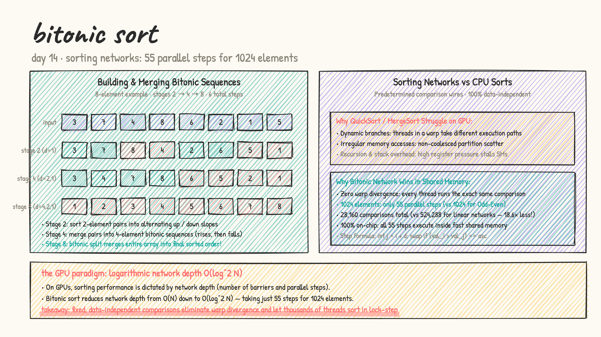
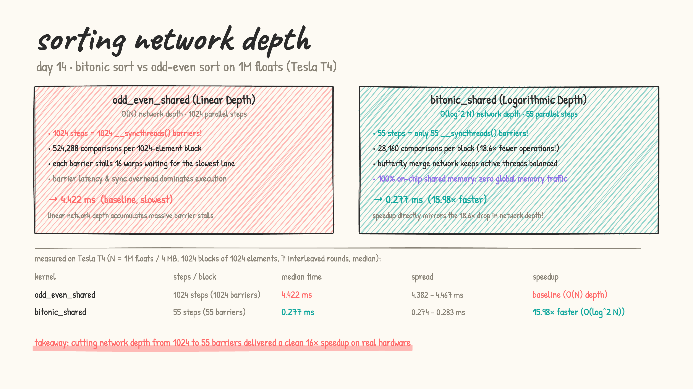

# Day 14: bitonic sort & sorting networks

- **from first principles:** why can't GPUs just run QuickSort or MergeSort?
  - CPU sorts rely on **dynamic, data-dependent branches** (pivots, conditional partitioning) and **recursion**.
  - On a GPU with 32-thread warps running in SIMT lock-step, data-dependent branching causes **severe warp divergence** — lanes that take the left branch stall the lanes that need the right branch. Non-coalesced partition scatter and stack overhead further degrade throughput.
  - Furthermore, scattering elements into unpredictable partitions causes non-coalesced memory accesses and stack/register spills.

- **the GPU solution: sorting networks:**
  - A sorting network has a **fixed, predetermined sequence of comparison wires**.
  - No matter what input values you give it, wire $i$ is compared with wire $j$ in a fixed schedule.
  - Every thread executes the **exact same instruction at the exact same cycle** $\rightarrow$ **zero warp divergence!**

- **what is a bitonic sequence?**
  - A sequence that monotonically increases, then monotonically decreases (or a circular shift of one).
  - Example: `[1, 3, 7, 8, 6, 4, 2, 0]` is bitonic.
  - **Bitonic Split Theorem:** If you take a bitonic sequence of length $2k$ and compare-and-swap pairs with stride $k$ (`if (a[i] > a[i+k]) swap(a[i], a[i+k])`), the sequence splits into two bitonic halves of length $k$, where **every element in half 1 $\le$ every element in half 2**!
  - Recursively halving the stride ($k/2, k/4 \dots 1$) completely sorts the sequence!

- **building bitonic sequences from scratch:**
  - For $N = 1024$ elements:
    - Stage 2: sort pairs into alternating ascending / descending slopes $\rightarrow$ produces 2-element bitonic sequences.
    - Stage 4: merge into 4-element bitonic sequences.
    - ...
    - Stage 1024: merge into a full 1024-element sorted array!
  - **Network depth:**
    $$\text{Steps} = \sum_{i=1}^{\log_2(N)} i = \frac{10 \times 11}{2} = 55 \text{ parallel steps!}$$
    For 1024 elements, 512 threads execute only **55 steps and 55 barriers** (28,160 total comparisons) entirely inside fast on-chip shared memory!
    In contrast, an Odd-Even Transposition network requires **1024 steps and 1024 barriers** (524,288 comparisons — $18.6\times$ more work).

  

- [bitonic_sort.cu](bitonic_sort.cu): LeetGPU format. Benchmarks sorting 1024-element blocks across $N = 1\text{M}$ floats ($1,048,576$ elements / 4 MB across 1024 blocks of 512 threads):
  1. `bitonic_shared`: 55 steps, 55 barriers, $O(\log^2 N)$ network depth in shared memory.
  2. `odd_even_shared`: 1024 steps, 1024 barriers, $O(N)$ network depth in shared memory.

  results on a real Tesla T4 (median of 7 interleaved rounds):

  | kernel | steps / block | time (median) | spread | speedup |
  |---|---|---|---|---|
  | `odd_even_shared` | 1024 steps (1024 barriers) | 4.422 ms | 4.382 – 4.467 ms | baseline (linear depth) |
  | `bitonic_shared` | 55 steps (55 barriers) | **0.277 ms** | 0.274 – 0.283 ms | **15.98× faster ($O(\log^2 N)$)** |

  

### The Hardware Analysis: Why is network depth everything on GPUs?

1. **The Cost of Synchronization Barriers**:
   Each `__syncthreads()` barrier forces all 16 warps in a block to pause and wait for the slowest warp before any thread can proceed. In `odd_even_shared`, the block encounters 1024 consecutive barriers, accumulating massive warp stall cycles. In `bitonic_shared`, the butterfly network sorts the entire block in only 55 barriers.
2. **$18.6\times$ Fewer Arithmetic Comparisons**:
   In `odd_even_shared`, 512 threads do 1024 passes $= 524,288$ comparisons per block.
   In `bitonic_shared`, 512 threads do 55 steps $= 28,160$ comparisons per block ($18.6\times$ less arithmetic).
   The measured **15.98× speedup** (0.277 ms vs 4.422 ms) almost perfectly reflects the $18.6\times$ reduction in network depth and synchronization!

- practice (my own solutions): kernel sheet #40 Sorting (bitonic) ★, #42 Top K ★
