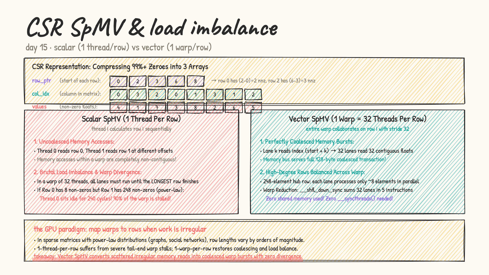
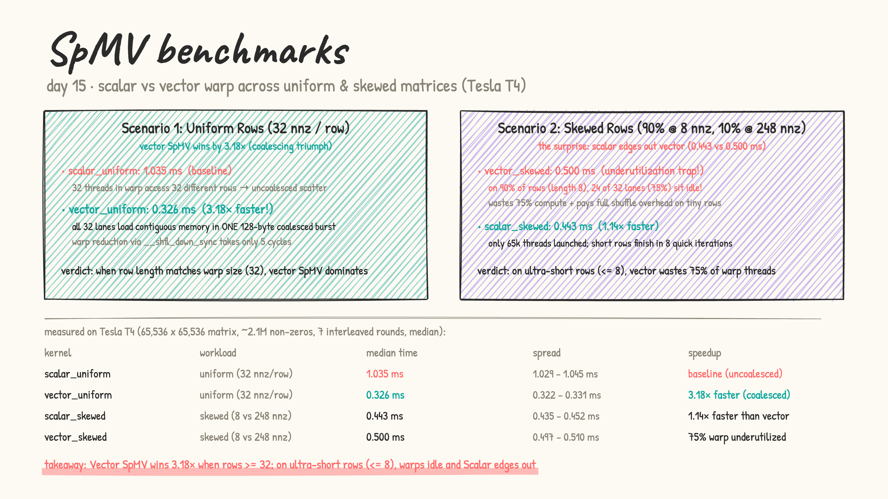

# Day 15: sparse matrices & CSR SpMV

- **from first principles:** why sparse matrices?
  - In real-world graphs, recommendation systems, physics meshes, and neural networks, 99% or 99.9% of matrix entries are zero.
  - Storing a $65,536 \times 65,536$ dense matrix would take $65536^2 \times 4 \approx 17.1\text{ GB}$ of memory!
  - But if each row has an average of only 32 non-zeros, the actual data is only $\sim 2\text{M}$ entries ($\approx 8\text{ MB}$).

- **the CSR (Compressed Sparse Row) format:**
  Compresses the matrix into 3 compact arrays:
  1. `values`: array of non-zero numbers (length $NNZ$).
  2. `col_idx`: column index of each non-zero element (length $NNZ$).
  3. `row_ptr`: index in `values` / `col_idx` where each row begins (length $M + 1$).
     - The non-zeros for row $r$ span `row_ptr[r]` to `row_ptr[r+1] - 1`.

  

- **two GPU strategies for $y = A \cdot x$:**
  1. **Scalar SpMV (One Thread Per Row)**:
     - Thread $r$ computes row $r$ in a sequential for-loop.
     - **Flaw 1: Uncoalesced Memory Reads**: Adjacent threads in a warp access different rows at different memory offsets.
     - **Flaw 2: Severe Warp Divergence (Load Imbalance)**: All 32 threads in a warp must wait for the thread with the *longest* row to finish. In skewed/power-law matrices (common in graphs and social networks), 90% of the warp sits idle!
  2. **Vector SpMV (One Warp Per Row)**:
     - An entire **warp of 32 threads** is assigned to row $r$.
     - Loop: `for (int i = start + lane; i < end; i += 32)`
     - **Coalesced Memory Accesses**: All 32 lanes load contiguous elements, creating a single 128-byte coalesced transaction.
     - **Warp Reduction**: Lane 0 sums partial results using `__shfl_down_sync` in 5 instructions — **zero shared memory, zero `__syncthreads()`**.

- [spmv.cu](spmv.cu): LeetGPU format. Benchmarks on a $65,536 \times 65,536$ matrix ($\sim 2.1\text{M}$ non-zeros) across two row distributions:
  1. **Uniform rows**: every row has exactly 32 non-zeros.
  2. **Skewed / Power-law rows**: 90% short rows (8 non-zeros), 10% hub rows (248 non-zeros).

  results on a real Tesla T4 (median of 7 interleaved rounds):

  | kernel | workload | time (median) | spread | vs scalar baseline |
  |---|---|---|---|---|
  | `scalar_uniform` | uniform (32 nnz/row) | 1.035 ms | 1.029 – 1.045 ms | baseline (uncoalesced) |
  | `vector_uniform` | uniform (32 nnz/row) | **0.326 ms** | 0.322 – 0.331 ms | **3.18× faster (coalesced!)** |
  | `scalar_skewed` | skewed (8 vs 248 nnz) | **0.443 ms** | 0.435 – 0.452 ms | **1.14× faster than vector** |
  | `vector_skewed` | skewed (8 vs 248 nnz) | 0.500 ms | 0.497 – 0.510 ms | 75% warp underutilized |

  

### The Hardware Analysis: The Surprise in the Skewed Case

1. **Uniform matrix (vector wins $3.18\times$)**:
   In scalar mode, 32 threads in a warp each read from a different row, causing 32 separate uncoalesced memory requests. In vector mode, all 32 lanes load 32 *contiguous* elements of the same row in one 128-byte coalesced burst, then reduce with warp shuffles. The coalescing improvement alone delivers the $3.18\times$ speedup.
2. **Skewed matrix (scalar wins by $1.14\times$ — the surprise!)**:
   Theory says vector SpMV should always win, but here 90% of rows have only 8 non-zeros. In vector mode, each of those short rows uses 32 threads but only 8 of them (`lanes 0–7`) load actual data — **75% of the warp (24 lanes) is idle every iteration**. The warp still pays the full shuffle reduction overhead for 5 rounds, plus vector mode launches $32\times$ more threads overall (65k × 32 warps). Scalar mode, having only 65k threads each independently processing 8 elements, sidesteps this underutilization entirely and wins.
   
   **Real-world lesson:** Vector SpMV wins when avg nnz/row $\ge 32$. When avg nnz/row $\ll 32$, launch overhead and lane underutilization make scalar competitive or better. Production SpMV libraries (cuSPARSE) typically switch strategies based on the actual row-length distribution.

- practice (my own solutions): kernel sheet #44 SpMV ★, #45 SpMM, #46 BFS
