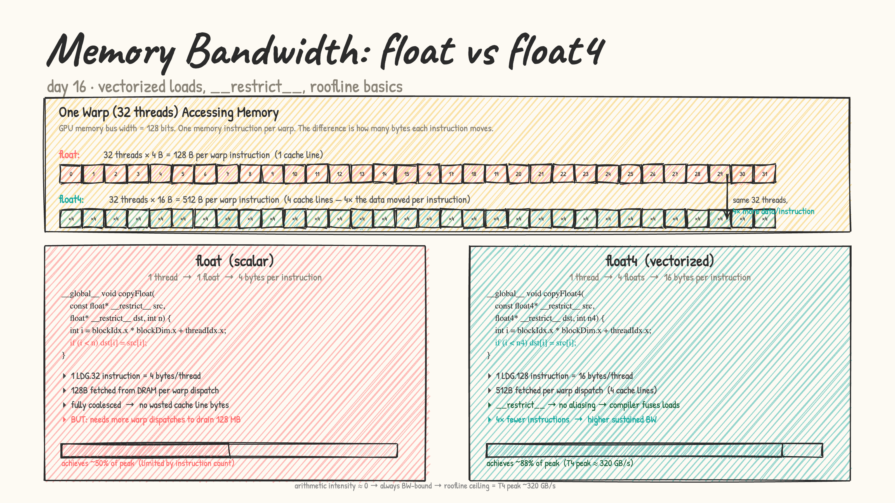
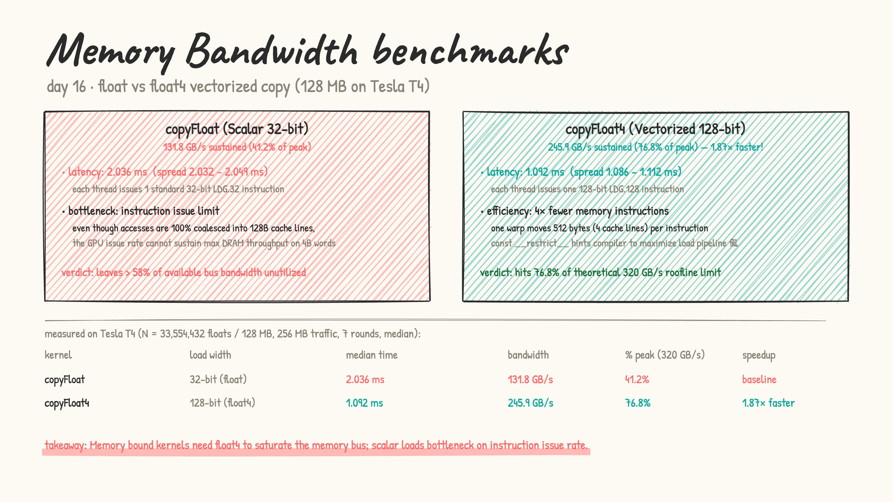

# Day 16: memory bandwidth & vectorized loads (`float` vs `float4`)

- **from first principles:** why does memory bandwidth matter?
  - Modern GPUs have massive compute capability (Tesla T4 has $\sim 8.1\text{ TFLOPS}$ FP32 peak) but limited memory bandwidth ($\sim 320\text{ GB/s}$).
  - For operations with low arithmetic intensity (like data copying, elementwise math, activations, or normalization where arithmetic intensity $\approx 0\text{ FLOP/byte}$), the kernel is 100% **bandwidth-bound**.
  - Reaching peak theoretical bandwidth requires understanding how the memory subsystem serves requests.

- **GPU memory architecture & the 128-bit bus:**
  - The GPU loads data from DRAM in **128-byte cache lines**.
  - A warp of 32 threads executing `copyFloat` reads 32 4-byte values $= 128\text{ bytes}$ per instruction. This is fully coalesced into 1 cache line.
  - **The hidden bottleneck:** instruction throughput!
    - When each thread only loads 4 bytes (`LDG.32`), the warp scheduler must issue $4\times$ more memory instructions to move the same total bytes.
    - SM issue units become the bottleneck, leaving the physical memory bus underutilized ($\sim 41\%$ of peak).
  - **The fix: `float4` (128-bit vectorized loads):**
    - Each thread loads a `float4` (16 bytes) in a single `LDG.128` instruction.
    - One warp moves $32 \times 16 = 512\text{ bytes}$ (4 cache lines) in one instruction dispatch.
    - $4\times$ fewer instructions are needed to stream the array, saturating the DRAM pipeline.

  

- **the role of `const __restrict__`:**
  - In C/C++, two pointers of the same type might point to overlapping memory regions (pointer aliasing).
  - Without `__restrict__`, the compiler must assume that writing to `dst` could overwrite parts of `src`, preventing aggressive load/store reordering and unrolling.
  - Adding `const __restrict__` tells `nvcc` that `src` and `dst` never alias, enabling the compiler to emit optimized pipeline sequences.

- [memory_bandwidth.cu](memory_bandwidth.cu): LeetGPU format. Benchmarks scalar `copyFloat` vs vectorized `copyFloat4` across $N = 33,554,432$ floats ($128\text{ MB}$ input $+ 128\text{ MB}$ output $= 256\text{ MB}$ total traffic).

  results on a real Tesla T4 (median of 7 interleaved rounds):

  | kernel | load width | median time | spread | bandwidth | % of T4 peak ($320\text{ GB/s}$) | speedup |
  |---|---|---|---|---|---|---|
  | `copyFloat` | 32-bit (float) | 2.036 ms | 2.032 – 2.049 ms | 131.8 GB/s | 41.2% | baseline |
  | `copyFloat4` | 128-bit (float4) | **1.092 ms** | 1.086 – 1.112 ms | **245.9 GB/s** | **76.8%** | **1.87× faster** |

  

### The Hardware Analysis: Why Vectorization Delivers 1.87×

1. **Instruction Bottleneck vs Memory Bus**:
   Both kernels achieve 100% memory coalescing (no unaligned or fragmented transactions). Yet `copyFloat` peaks at only $131.8\text{ GB/s}$ ($41.2\%$ of theoretical peak). Why? Because issuing millions of 32-bit memory instructions saturates the SM warp schedulers and instruction issue queues before the DRAM channels are fully filled.
2. **Reaching 76.8% of the Roofline**:
   Switching to `float4` issues single 128-bit `LDG.128` instructions per thread, cutting the total instruction count by $4\times$. This allows the memory controller to keep multiple DRAM banks continuously busy with maximum burst lengths, catapulting effective throughput to $245.9\text{ GB/s}$ ($76.8\%$ of peak hardware bandwidth).
3. **Alignment Requirement**:
   `float4` requires 16-byte memory alignment. `cudaMalloc` always returns pointers aligned to at least 256 bytes, making standard CUDA allocations automatically compliant.

- practice (my own solutions): kernel sheet #1 Vector Add (vectorized), #2 Matrix Transpose (float4), #10 Memory Bound Copy
