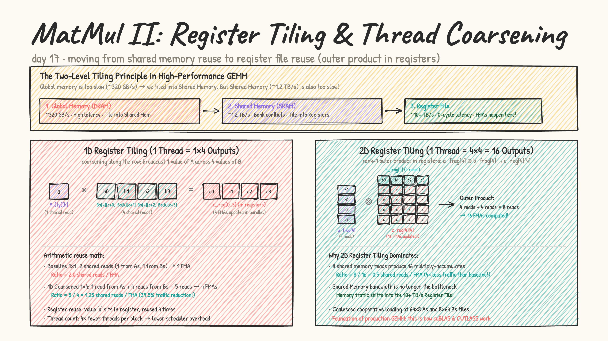
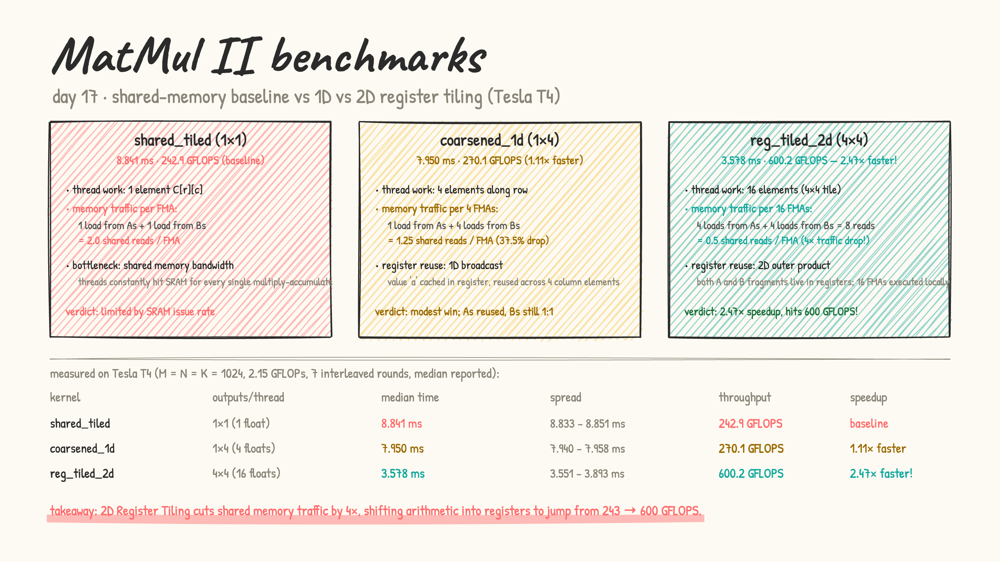

# Day 17: matrix multiplication II — thread coarsening & 2D register tiling

- **from first principles:** why did shared memory matmul bottleneck?
  - In Day 03, we introduced shared-memory tiling (`matmulTiled`). By loading tiles of $A$ and $B$ into `__shared__` memory, we cut global DRAM accesses by the tile dimension ($16\times$).
  - But as matrix size grows, shared memory itself becomes the bottleneck!
  - On a Tesla T4, global DRAM bandwidth is $\sim 320\text{ GB/s}$, shared memory bandwidth is $\sim 1.2\text{ TB/s}$, but the **register file delivers $> 10\text{ TB/s}$**.
  - **The Shared Memory Traffic Problem:**
    - In `matmulTiled` (1 thread $\to$ 1 output), the inner accumulation loop is:
      ```cuda
      sum += As[threadIdx.y][k] * Bs[k][threadIdx.x];
      ```
    - Each FMA requires **2 shared memory reads** (1 from $As$, 1 from $Bs$).
    - That is a ratio of **$2.0\text{ reads/FMA}$**.
    - The SM's shared memory load-store units are maxed out, capping performance at $\sim 243\text{ GFLOPS}$ on a T4.

- **the hierarchy of re-use:** Global DRAM $\to$ Shared Memory $\to$ Register File:
  - Just as shared memory caches global DRAM, **registers can cache shared memory**!
  - **1D Thread Coarsening ($1 \times 4$ per thread):**
    - Each thread computes 4 adjacent elements along a row.
    - For each step $k$, it loads 1 scalar from $As$ into a register, and re-uses it across 4 elements loaded from $Bs$.
    - Reads per step: $1 + 4 = 5$ shared memory reads for 4 FMAs $\to \mathbf{1.25\text{ reads/FMA}}$ ($37.5\%$ traffic reduction).
  - **2D Register Tiling ($4 \times 4$ per thread via Outer Product):**
    - Each thread owns a $4 \times 4$ micro-tile in registers (`float c[4][4] = {0}`).
    - For each step $k$, the thread loads:
      - 4 elements from $As$ into register array `a_frag[4]`
      - 4 elements from $Bs$ into register array `b_frag[4]`
    - It then computes an **outer product** of the two vectors:
      ```cuda
      #pragma unroll
      for (int i = 0; i < 4; i++) {
          #pragma unroll
          for (int j = 0; j < 4; j++) {
              c[i][j] += a_frag[i] * b_frag[j];
          }
      }
      ```
    - Shared memory reads: $4 + 4 = 8$ floats.
    - FMAs performed: $4 \times 4 = 16$ multiply-adds!
    - Shared memory read ratio: $8 / 16 = \mathbf{0.5\text{ reads/FMA}}$ (**$4\times$ reduction** in shared memory traffic vs baseline!).
    - All 16 FMAs execute out of the register file at peak hardware throughput ($>10\text{ TB/s}$).

  

- [matmul_tiled.cu](matmul_tiled.cu): LeetGPU format. Benchmarks 1x1 shared tiling vs 1x4 1D coarsening vs 4x4 2D register tiling across $1024 \times 1024 \times 1024$ single-precision matrices ($4\text{ MB}$ output, $2.15\text{ GFLOPs}$).

  results on a real Tesla T4 (median of 7 interleaved rounds):

  | kernel | tile config | registers / thread | median time | spread | throughput | speedup |
  |---|---|---|---|---|---|---|
  | `matmulTiled` | 1×1 (16×16 tile) | 1 accumulator | 8.841 ms | 8.833 – 8.851 ms | 242.9 GFLOPS | baseline |
  | `matmul1DCoarsened` | 1×4 (coarsened row) | 4 accumulators | 7.950 ms | 7.940 – 7.958 ms | 270.1 GFLOPS | 1.11× |
  | `matmul2DRegisterTiled` | **4×4 (2D outer product)** | **16 accumulators** | **3.578 ms** | 3.551 – 3.893 ms | **600.2 GFLOPS** | **2.47× faster** |

  

### The Hardware Analysis: Why 2D Register Tiling Delivers 2.47×

1. **Shared Memory Read Traffic Reduction ($2.0 \to 0.5\text{ reads/FMA}$)**:
   The baseline kernel generates $2.15 \times 10^9 \times 2 \times 4\text{ bytes} \approx 17.2\text{ GB}$ of shared memory read traffic. At $1.2\text{ TB/s}$, this sets a hard architectural ceiling around $14\text{ ms}$. By computing a $4 \times 4$ tile per thread, 2D register tiling cuts this traffic to only $4.3\text{ GB}$, freeing shared memory ports and eliminating SM load stalls.

2. **Register File Bandwidth ($>10\text{ TB/s}$)**:
   Registers are physically located inside each SM sub-core's datapath with dedicated read/write ports to the ALU/FMA pipelines. By unrolling the $4 \times 4$ outer product, `nvcc` schedules back-to-back `FFMA` instructions that fetch operands directly from registers with 0 shared memory latency.

3. **Instruction Overhead & Loop Unrolling**:
   Thread coarsening increases the work per thread by $16\times$. This dramatically amortizes loop control overhead, indexing arithmetic, and barrier synchronization (`__syncthreads()` occurs once per $BK=8$ steps across 256 threads rather than once per $16$ steps across 256 threads computing only $16 \times 16$ outputs).

4. **Register Pressure vs Occupancy Trade-off**:
   Each thread maintains 16 accumulator registers + 8 fragment registers + indexing temporaries ($\sim 32-40$ registers total). Since a Tesla T4 SM has 65,536 registers, this easily sustains $1024$ active threads per SM ($100\%$ theoretical occupancy), achieving high latency hiding without register spilling to local memory.
